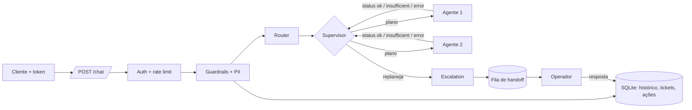

# {{NOME DO PROJETO}}

{{Uma frase: o que o sistema faz e para quem.}}

| | |
|---|---|
| Rodar | `docker compose up -d --build` → `http://localhost:8000/docs` |
| Testar | `python scripts/check.py --docker` (lint, testes, eval com gate, build e smoke do container) |
| Vídeo | {{link}} |

## 1. Como rodar

```bash
cp .env.example .env                      # opcional: sem chave roda no modo offline determinístico
docker compose up -d --build
curl -s localhost:8000/health
TOKEN=$(python -m app.auth u1)            # token de desenvolvimento assinado para o usuário u1
curl -s -X POST localhost:8000/chat -H "Authorization: Bearer $TOKEN" \
     -H "Content-Type: application/json" -d '{"message":"Onde está meu pedido 1002?"}'
```

Operador humano (fila de handoff): `GET /handoffs` e `POST /handoffs/{id}/reply` com o
header `X-Operator-Token`. A resposta entra na conversa do cliente
(`GET /conversations/{id}`) e o próximo turno já a enxerga.

## 2. Arquitetura



{{Por que essa divisão: uma fonte de verdade por agente; contrato em src/app/schemas.py.}}

## 3. Cobertura da régua de avaliação

| Critério | Onde está | Teste / evidência |
|---|---|---|
| Orquestração com replanejamento | `supervisor.py` (PLANS, FALLBACK, MAX_STEPS) | `test_supervisor_replans_when_no_source`, eval split `replan` |
| RAG com métrica de retrieval | `rag.py` (BM25 + radical) | eval: Recall@3 e MRR por split |
| Tools com JSON Schema e confirmação | `tools.py` | `test_write_action_needs_owner_confirmation`, `test_tool_identity_is_server_side` |
| Identidade e rate limit | `auth.py`, `api.py` | `test_chat_requires_token`, `test_identity_comes_from_token_not_body`, `test_rate_limit` |
| Memória persistida | `store.py` | `test_follow_up_uses_record_from_history`, `test_history_survives_restart` |
| Human-in-the-loop com retomada | `/handoffs`, `store.answer_ticket` | `test_handoff_operator_reply_and_resume` |
| Avaliação | `evals/run_evals.py`, `evals/judge.py` (+ calibração humana) | gate no CI; tabela abaixo |
| Custo e observabilidade | `observability.py` (spans, tokens, US$ por request) | `usage` na resposta, `/metrics`, `test_cost_per_request_from_price_table` |
| Produção | Dockerfile multi-stage não-root, `requirements*.lock` | `check.py --docker` no CI |

## 4. Decisões e trade-offs

| Decisão | Alternativa descartada | Motivo |
|---|---|---|
| Replanejamento por tabela no supervisor | LLM decidindo o próximo agente | determinístico e testável; o LLM pode entrar em `next_step` sem mudar o laço |
| BM25 + métrica de retrieval | embeddings desde o início | com dezenas de documentos, medir antes de trocar |
| SQLite atrás de `Store` | Postgres/Redis | sobe com um comando; a troca para réplicas fica isolada num módulo |
| {{...}} | {{...}} | {{...}} |

## 5. Avaliação

Números gerados por `python scripts/fill_readme.py` a partir de `evals/results/latest.json`.

<!-- eval:begin -->
<!-- eval:end -->

## 6. Spec e rastreabilidade

Spec em [docs/SPEC.md](docs/SPEC.md), commitada antes do código.

## 7. Linha do tempo (git log)

<!-- timeline:begin -->
<!-- timeline:end -->

## 8. Scaffold declarado

A infraestrutura genérica vem de um kit próprio, preparado antes do desafio e reutilizado:
- FastAPI, Docker, CI e lockfiles;
- runner de eval e juiz;
- auth, rate limit, memória, fila de handoff e supervisor;
- logs, métricas e custo.

Ela está no primeiro commit (`chore: scaffold`). Tudo o que é específico do desafio veio
depois e está nos commits seguintes.

## 9. Limitações e próximos passos

- {{o que é simulado}}
- Rate limit e cache em memória do processo; com réplicas, mover para Redis.
- {{o que ficou de fora e por quê}}
