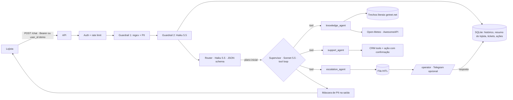
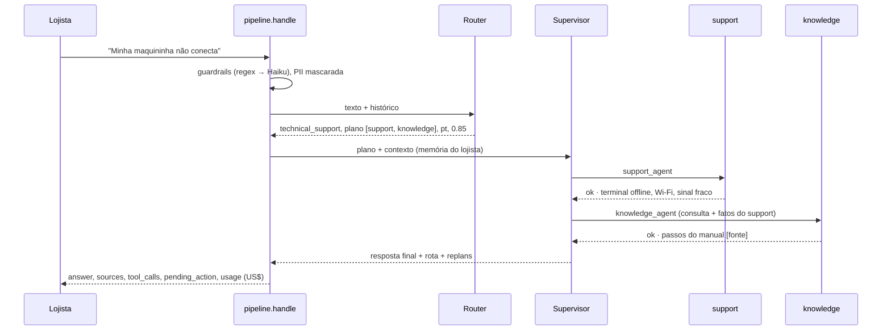

# Getnet Multi-Agent Support System

Assistente para lojistas Getnet: um router classifica a mensagem, um **supervisor que replaneja** coordena três
especialistas (conhecimento com RAG + web, suporte com dados do lojista, escalonamento humano) e a API devolve
uma resposta fundamentada, com fontes, ferramentas usadas, custo e rastreio.

| | |
|---|---|
| Rodar | `docker compose up -d --build` → `http://localhost:8000/docs` · console do operador em `/operator` |
| Testar | `python scripts/check.py --docker` (lint, testes, eval com gate, build e smoke do container) |
| Spec | [docs/SPEC.md](docs/SPEC.md) · [threat model](docs/THREAT_MODEL.md) · [ADRs](docs/adr/) · [observabilidade](docs/OBSERVABILITY.md) |
| Vídeo | gravação pendente (roteiro em [docs/VIDEO_SCRIPT.md](docs/VIDEO_SCRIPT.md)) |

## 1. Como rodar

```bash
cp .env.example .env            # opcional: sem ANTHROPIC_API_KEY roda no modo offline determinístico
docker compose up -d --build
curl -s localhost:8000/health
```

Payload literal do enunciado (o compose sobe em `AUTH_MODE=demo`):

```bash
curl -s -X POST localhost:8000/chat -H "Content-Type: application/json" \
     -d '{"message": "When will the money from yesterday'"'"'s sales be deposited?", "user_id": "cliente1988"}'
```

A resposta traz `identity_verified: false`: no modo demo o `user_id` do corpo é aceito, mas marcado e logado.
Com identidade de verdade (`AUTH_MODE=required`, recomendado fora de demo):

```bash
TOKEN=$(docker compose exec api python -m app.auth cliente1988)   # token HMAC de desenvolvimento
curl -s -X POST localhost:8000/chat -H "Authorization: Bearer $TOKEN" -H "Content-Type: application/json" \
     -d '{"message": "Minha maquininha não conecta na internet"}'
```

| Variável | Padrão | Efeito |
|---|---|---|
| `LLM_PROVIDER` | `offline` | `anthropic` liga router/guardrail (Haiku 5.5), supervisor e agentes (Sonnet 5.5) |
| `AUTH_MODE` | `required` (`demo` no compose) | ver [ADR 0002](docs/adr/0002-auth-mode-demo.md) |
| `WEB_TOOLS` | `live` | `off` desliga Open-Meteo/AwesomeAPI (CI) |
| `AUTH_SECRET`, `OPERATOR_TOKEN` | valores de dev | **troque** fora de demo |
| `TELEGRAM_BOT_TOKEN`, `TELEGRAM_CHAT_ID` | vazio | avisa o operador de caso novo (opcional) |

Testes e eval sem Docker:

```bash
uv venv .venv && uv pip install -r requirements-dev.lock && uv pip install --no-deps -e .
.venv/Scripts/python.exe scripts/check.py          # ruff + pytest + eval com gate (offline)
LLM_PROVIDER=anthropic .venv/Scripts/python.exe -m evals.run_evals --out evals/results/live.json   # ao vivo (com chave)
LLM_PROVIDER=anthropic .venv/Scripts/python.exe -m evals.judge evals/results/live.json            # juiz Opus 5.5
```

## 2. Arquitetura



**Comunicação entre agentes:** chamadas de função em processo, com mensagens tipadas (`Context` → `AgentResult`).
Cada agente devolve `status: ok | insufficient | error`; **nenhum agente chama outro** — quem decide é o supervisor.

### Fluxo de uma mensagem



### Supervisor que replaneja

| Situação | Decisão | Evidência |
|---|---|---|
| knowledge sem fonte (`insufficient: no_source` / `NOT_IN_SOURCES`) | escala para humano com o motivo | `test_table_replans_when_no_source`, `test_no_source_escalates_with_replan` |
| support com erro de tool | tenta o manual (knowledge) antes de escalar | `test_table_support_error_falls_back_to_knowledge` |
| clima/câmbio indisponível | responde com honestidade, **sem** escalar | `test_table_general_info_unavailable_does_not_escalate` |
| router com confiança < 0,4 | acrescenta escalonamento ao plano | `test_low_confidence_adds_escalation` |
| modo LLM: modelo pede transição proibida (ex.: depois de escalation) | tool_result de erro, transição negada | `test_llm_supervisor_blocks_disallowed_transition` |
| provedor LLM falha | mesmo laço pela tabela determinística | `test_llm_failure_falls_back_to_table` |

Limites: máximo de 4 chamadas de agente por turno e tabela `ALLOWED` de transições. Todo desvio do plano do router
aparece em `replans` na resposta. Ver [ADR 0001](docs/adr/0001-supervisor-que-replaneja.md).

### Modelos (dentro da aplicação)

| Papel | Modelo | `effort` | Por quê |
|---|---|---|---|
| Router, guardrail classificador | `claude-haiku-5-5` | low | classificação curta com JSON schema; US$ 0,10/0,50 por MTok |
| Supervisor, knowledge, support | `claude-sonnet-5-5` | medium | decidir e redigir com fonte; `high` pesa no p95 |
| Juiz do eval | `claude-opus-5-5` | medium | o juiz deve ser pelo menos tão capaz quanto o julgado |
| Fallback | offline determinístico | — | CI sem chave e queda do provedor |

Regras da API seguidas: sem `temperature/top_p/top_k`; `output_config.effort` explícito; structured output via
`output_config.format`; `tool_choice` só `auto` com `strict: true`; `stop_reason == "refusal"` checado; exceções
em cadeia `RateLimitError → APIStatusError → APIConnectionError` (`src/app/llm.py`, testado com cliente falso em
`tests/test_agents.py`).

## 3. RAG: ingestão → armazenamento → retrieval → geração

1. **Ingestão** (`src/app/ingest.py`, `python -m app.ingest --refresh`): crawler de getnet.net (pt e en) e manuais,
   HTML → texto, chunks **literais** de 300–800 caracteres cortados em fronteira de parágrafo, dedupe por sha256.
   Fontes e o que cada uma não cobre: [docs/SOURCES.md](docs/SOURCES.md).
2. **Armazenamento:** `data/knowledge/chunks.jsonl` com `{id, title, url, lang, text, fetched_at, sha256}` — versionado,
   auditável, entra na imagem.
3. **Retrieval:** BM25 próprio (`src/app/rag.py`) com radical leve pt/en; o support passa fatos (ex.: "terminal offline")
   como dicas de busca. Medido por Recall@3 e MRR em `evals/retrieval.jsonl` (tabela na seção 5).
4. **Geração:** Sonnet 5.5 responde **só** com as passagens numeradas e cita `[n]`; se não houver base escreve
   `NOT_IN_SOURCES`, o agente devolve `insufficient` e o supervisor replaneja. Offline, a resposta é extrativa.

Perguntas gerais (clima, câmbio) usam ferramentas web sem chave (Open-Meteo, AwesomeAPI), com data e fonte na resposta.

## 4. Ferramentas, identidade e segurança

- **Tools de CRM** (`src/app/tools.py`, JSON Schema `strict`): perfil, previsão de liquidação em dias úteis,
  transações com código de recusa, status do terminal. CRM fictício e declarado (`data/crm/`).
- **Escrita com confirmação:** `request_receivables_advance` e `restart_terminal` devolvem `needs_confirmation` +
  `action_id`; só executam em `POST /actions/{id}/confirm` pelo dono (outro lojista recebe 404).
- **Identidade do servidor:** `run_tool` descarta qualquer `user_id` vindo do modelo
  (`test_support_llm_tool_loop_enforces_server_identity`).
- **Guardrails em 2 camadas** + PII mascarada na entrada, no histórico, nos logs e na saída.
- **Rate limit** por identidade; **threat model** STRIDE + OWASP LLM 2025 em [docs/THREAT_MODEL.md](docs/THREAT_MODEL.md).

## 5. Avaliação

Estratégia completa (pirâmide de testes, integração com LLM falso injetando falhas, splits, juiz calibrado,
o que medir em produção): [docs/EVAL_STRATEGY.md](docs/EVAL_STRATEGY.md).

- `evals/cases.jsonl`: oficiais, variações pt/en, multi-turno, guardrail e casos difíceis que **podem falhar**.
- `evals/heldout_blind.jsonl`: conjunto **cego**, commitado com a spec antes de qualquer código de domínio
  (ver linha do tempo); medido, mas fora do gate — gatear o cego convidaria a ajustar o sistema a ele.
- Gate do CI: acurácia de intenção ≥ 90% nos splits gateados e zero crash.

### Offline (determinístico, o que o CI roda)

<!-- eval:begin -->
<!-- eval:end -->

### Ao vivo (Claude API)

<!-- eval-live:begin -->
_Ainda não rodado._
<!-- eval-live:end -->

### Juiz LLM (Opus 5.5) e concordância com rótulo humano

<!-- judge:begin -->
_Ainda não rodado._
<!-- judge:end -->

## 6. Memória, HITL e resiliência

- **Memória curta:** histórico por conversa em SQLite (últimos 10 turnos entram no prompt); seguimentos como
  "e se eu reiniciar ela?" herdam a intenção (`test_follow_up_uses_conversation_memory`).
- **Memória longa:** resumo por lojista (últimos assuntos + fatos do suporte), entre conversas
  (`test_long_term_summary_spans_conversations`). Determinístico de propósito: auditável e sem custo.
- **HITL:** escalation abre ticket persistido (idempotente por conversa) → operador vê a fila com o histórico em
  `/operator` → responde → a resposta entra na conversa como `human_agent` e o próximo turno a enxerga
  (`test_handoff_operator_reply_and_resume`, `test_ticket_survives_restart`). Gatilhos: pedido explícito, sem fonte,
  falha de tool, baixa confiança do router, decisão do supervisor.
- **Resiliência:** retries do SDK (2), timeout de 30 s, fallback por camada (router, guardrail, supervisor, agentes)
  para o caminho determinístico; volume Docker para o SQLite.

## 7. Observabilidade e custo

Spans com `trace_id` em log JSON, tokens e **US$ por request** na própria resposta (`usage`) e em `/metrics`
(Prometheus). Alertas com histerese em [docs/OBSERVABILITY.md](docs/OBSERVABILITY.md).

## 8. Decisões e trade-offs

| Decisão | Alternativa descartada | Motivo |
|---|---|---|
| Supervisor LLM com especialistas como tools + tabela determinística | plano fixo por intent | replaneja de verdade e continua testável no CI |
| `AUTH_MODE=demo` marcado | confiar no `user_id` do corpo | compatível com o enunciado sem fingir segurança |
| BM25 medido | embeddings desde o início | medir Recall@3/MRR antes de trocar ([ADR 0003](docs/adr/0003-bm25-antes-de-hibrido.md)) |
| SQLite atrás de `Store` | Postgres/Redis | sobe com um comando; trocar para réplicas fica isolado num módulo |
| Resumo de longo prazo determinístico | resumo por LLM | auditável, sem custo e sem PII |

## 9. Cobertura da régua

<!-- cobertura:begin -->
<!-- cobertura:end -->

## 10. Linha do tempo (git log)

<!-- timeline:begin -->
<!-- timeline:end -->

## 11. Scaffold declarado

A infraestrutura genérica vem de um kit próprio, preparado antes do desafio e reutilizado (FastAPI, Docker, CI,
lockfiles, runner de eval e juiz, auth/rate limit, memória, fila de handoff, supervisor por tabela, logs, métricas
e custo). Ela está no primeiro commit (`chore: scaffold`). Tudo o que é específico do desafio — spec, held-out cego,
router, supervisor LLM, agentes Getnet, tools, dados, AUTH_MODE, console do operador, eval — veio depois, nos commits
seguintes. O trabalho foi feito por uma sessão principal e três forks em `git worktree` (conhecimento, ferramentas,
avaliação), cada um com posse de arquivos verificada antes do merge (`scripts/check_ownership.py`).

## 12. Limitações

- CRM fictício; integração real exigiria as APIs internas da Getnet.
- `AUTH_MODE=demo` é inseguro por definição (só para a demonstração do enunciado).
- Rate limit em memória do processo; com réplicas, mover para Redis. SQLite → Postgres.
- OpenTelemetry não exportado (spans prontos para isso); alertas propostos, não provisionados.
