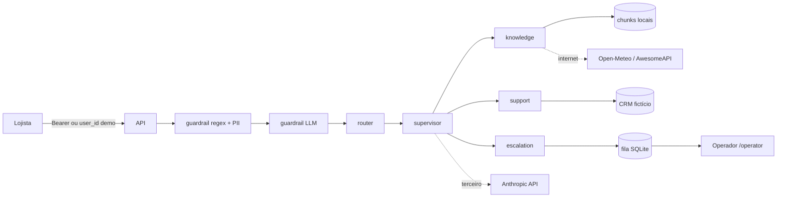

# Threat model (STRIDE + OWASP LLM Top 10 2025 / agêntico)

Escopo: `POST /chat`, console `/operator`, ações com confirmação, chamadas ao provedor LLM, web tools.

## Fluxo de dados e fronteiras de confiança

Fronteiras: internet (lojista e web tools), terceiro (provedor LLM), operador humano.

## STRIDE

| Ameaça | Elemento | Controle implementado | Evidência | Risco residual |
|---|---|---|---|---|
| S — lojista se passa por outro | `/chat` | `AUTH_MODE=required`: user_id só do token HMAC; `demo` marca `identity_verified=false` e loga | `tests/test_scenarios.py`, `tests/test_api.py` | modo demo é inseguro por definição |
| S — operador falso | `/handoffs`, `/operator` | `X-Operator-Token` com `hmac.compare_digest` | `tests/test_memory_and_handoff.py` | token estático; produção: SSO |
| T — modelo altera user_id da tool | tools | `run_tool` sobrescreve `user_id` com o do servidor | `tests/test_tools.py` | — |
| T — ação sem consentimento | escrita | `needs_confirmation` + `POST /actions/{id}/confirm` só pelo dono | `tests/test_tools.py` | — |
| R — negar ação | ações | tabela `actions` com status e resultado; logs JSON com trace_id | `store.py` | logs não assinados |
| I — dado de outro lojista | CRM, conversa | inexistente e de outro dono = mesmo `not_found`; conversa de outro = 403 | testes | — |
| I — PII em log/LLM | entrada/saída | máscara de cartão (Luhn), CPF, e-mail antes de agente e log; máscara na saída | `tests/test_guardrails.py` | PII em texto livre |
| D — abuso/custo | `/chat` | rate limit por identidade, máx. 4 passos, `max_tokens` por chamada | `tests/test_api.py` | limiter em memória (réplicas → Redis) |
| E — injection escala privilégio | supervisor | guardrail 2 camadas; tools só leem o próprio lojista; escrita exige confirmação | eval split `guardrail` | injection indireta via página crawleada |

## OWASP LLM 2025
- LLM01 Prompt injection: regex + classificador Haiku; passagens RAG entram como dados delimitados.
- LLM02 Sensitive info disclosure: PII mascarada; identidade do servidor; `not_found` uniforme.
- LLM05 Improper output handling: saída do LLM é texto; nenhuma saída vira SQL/shell; JSON validado por schema.
- LLM06 Excessive agency: escrita só com confirmação; máx. 4 passos; transições permitidas.
- LLM09 Misinformation: knowledge responde só com passagens (`NOT_IN_SOURCES` → replaneja/escala); juiz mede grounding.
- LLM10 Unbounded consumption: rate limit, `max_tokens`, custo por request em métrica.

## Decisões de risco deixadas a pessoas
- Ativar `AUTH_MODE=required` em qualquer ambiente fora de demo.
- Trocar `AUTH_SECRET` e `OPERATOR_TOKEN` padrão.
